# Phase 4：調査導線の一本化

2026-11-06。比較元はPhase 3cの `4d76be0`。バックエンドのAPI・保存形式・設定は変更していない。

## 変更した操作

- 上部は「調査」「設定」。5段階ナビを両タブの外に配置し、スクロール中も表示する。無効な段階には理由をtitleで示す。
- 調査条件の4入口はラジオ選択。旧00〜03ステッパー・パンくず・探索ラボのピル導線は撤去した。
- 要素・観点には発明要素／従来の観点編集／分類コンステレーション／探索ラボ、結果・判定には特許マップ／判断エージェント、次の式へには検索式の改善／統括を配置した。過去式モードでは式例の編集へ戻れる。
- 入力・要素確認はstage引数から直接描画する。既存DOMをdetailsで包む、挿入して見出しや表示状態を書き換える処理は撤去した。
- 特許または検索式が存在すればヒーローは1行。注意書きは元の文言のまま「?」へ移し、操作エラー・分類根拠・必須確認はその場に残した。
- 統括の未保存の判断基準は空欄。保存済みの基準は維持する。

## 検証

| 確認 | 結果 |
|---|---|
| Python unittest全件 | 542件実行、541成功、既存の任意Transformerテスト1件スキップ |
| JavaScript node:test全件 | 309件成功（304件を維持、ナビ回帰5件追加） |
| Playwright / Edge、1440×900 | 成功、ページ例外0件 |
| 実行データ | 一時ディレクトリの隔離Workspace、架空CSV8件。外部通信をブラウザーで遮断、LLM・OPS実行なし |

ブラウザーでは4モードの切替、手動要素の入力・計画・プレビュー・検索式保存、CSV取込、必要4件・不要4件の判定、改善画面、各補助機能、設定を操作した。段階往復・再読み込み後の入力保持、特許行のhover、スクロール時のナビ、初回／キャッシュ再描画後のヘルプも確認した。

旧入口カードに対するテストは同じ4機能のラジオ選択へ、旧DOMラップのテストはstage別の直接描画へ置換した。個別機能／式例モードを勝手にターゲットモードへ変える期待値は、選択モードを保持する期待値へ変更。統括のキーワード自動入力の期待値は、指定された空欄へ変更した。テストの削除・新規スキップはない。

再実行（Playwrightとブラウザーは開発環境に別途必要。アプリの依存には追加していない）:

```sh
.venv/bin/python -m unittest discover -s tests -v
node --test tests/*.test.cjs
node tests/phase4-browser.cjs
```

Windowsは `.venv\Scripts\python.exe` を使用。Playwrightが通常の探索先にない場合は `NODE_PATH`、ブラウザーの場所は `PLAYWRIGHT_EXECUTABLE_PATH` を指定できる。画面テストは自分専用の一時Workspaceとサーバーを生成・終了し、既存サーバーや実Workspaceには接続しない。

## 画面

すべて1440×900、架空データ。主要5段階と補助機能の画像をPRにも掲載する。

| 調査条件 | 要素・観点 |
|---|---|
| 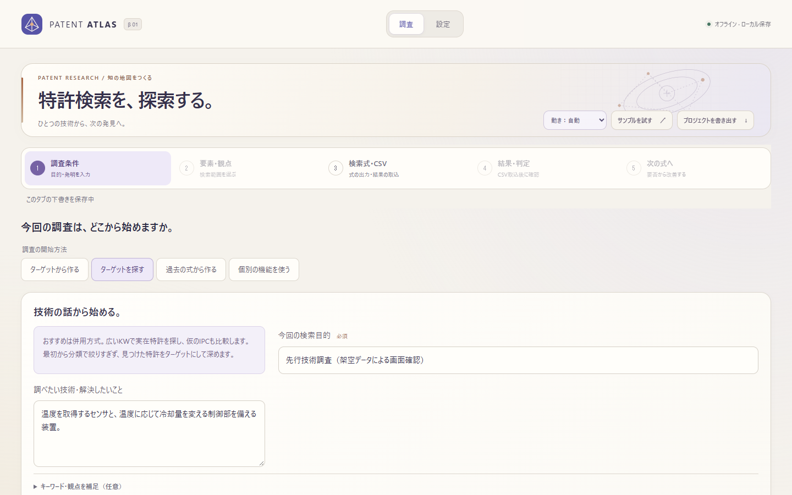 | 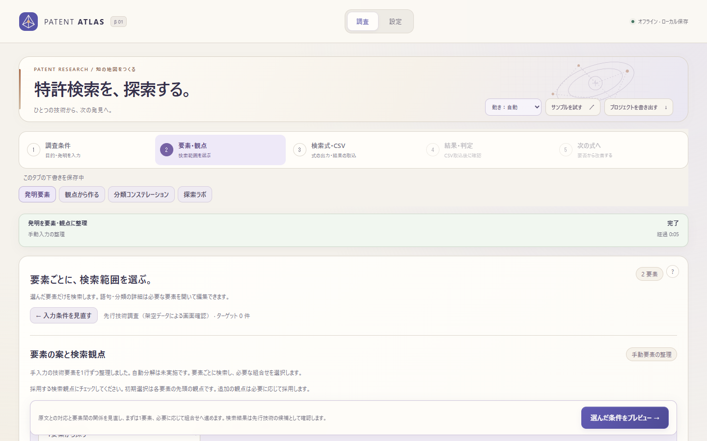 |

| 検索式・CSV | 結果・判定 |
|---|---|
| 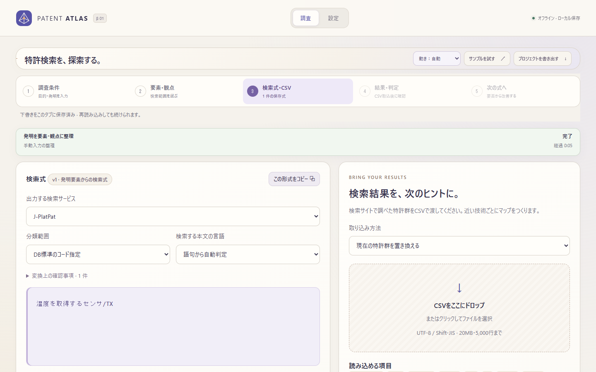 | 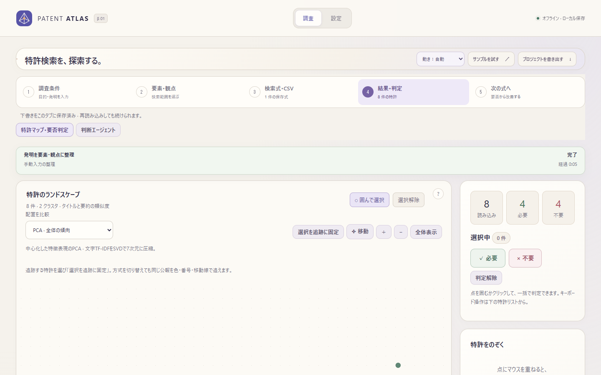 |

| 次の式へ | マップの詳細 |
|---|---|
| 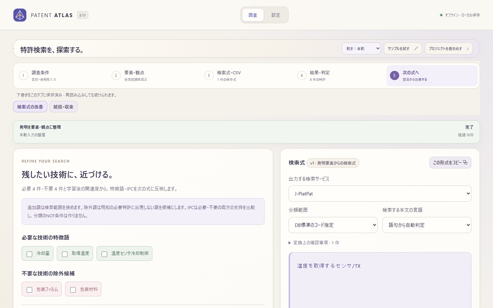 | 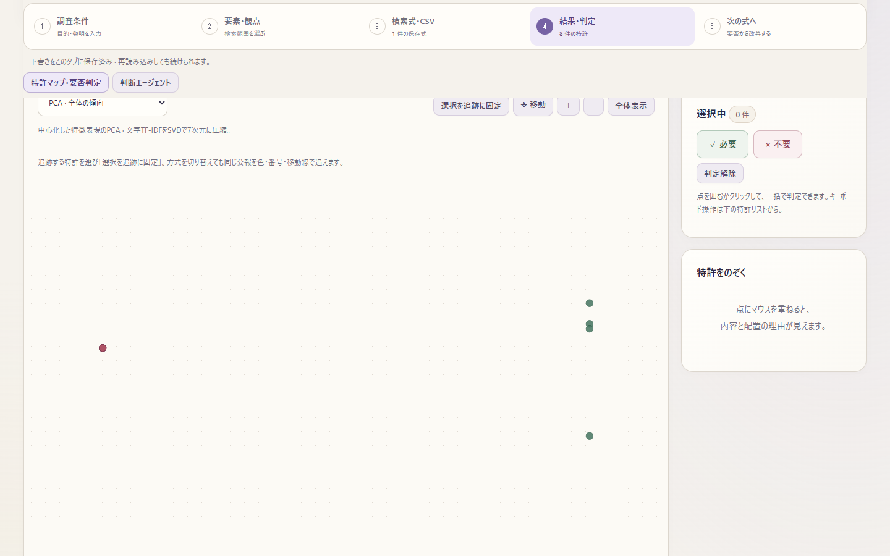 |

| 探索ラボ | 判断エージェント |
|---|---|
| 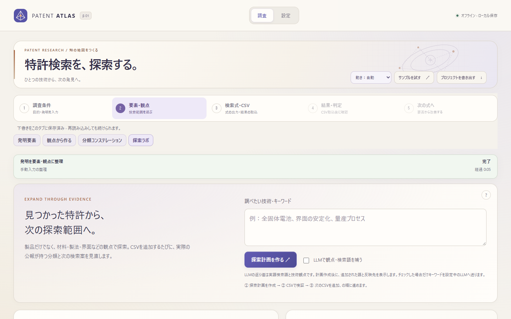 | 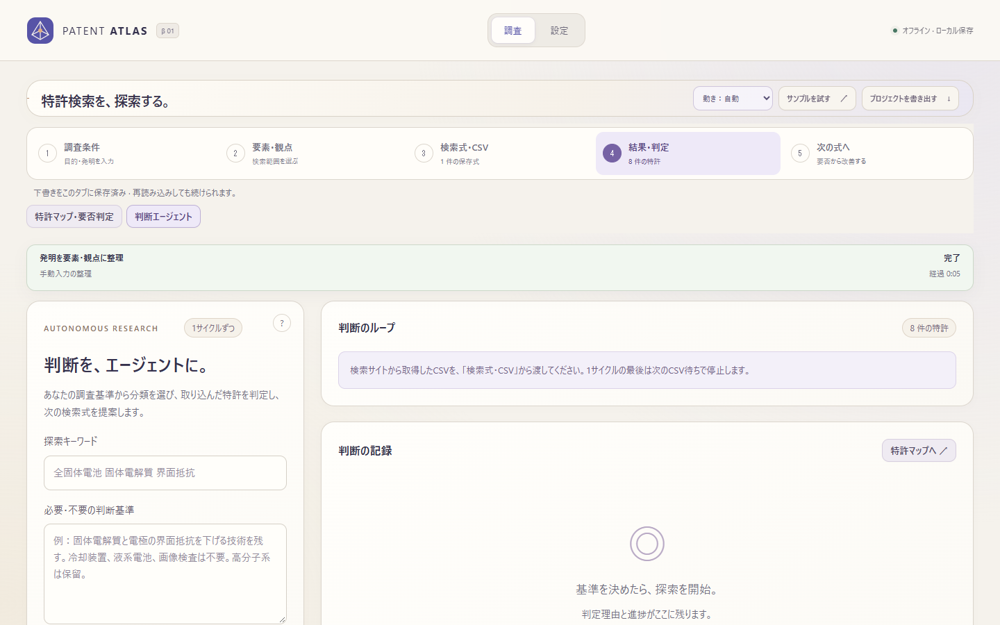 |

| 統括・収束 | 設定 |
|---|---|
| 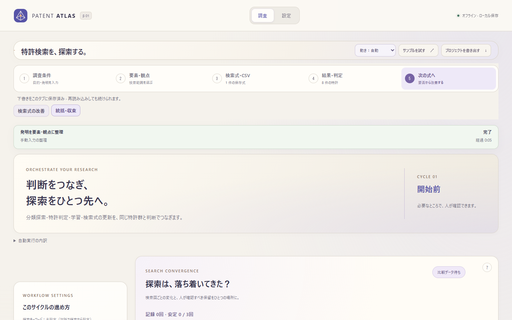 | 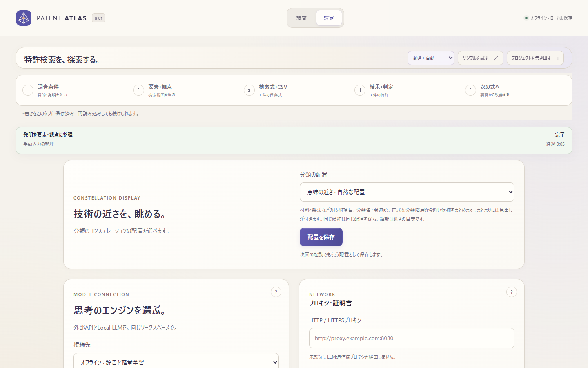 |

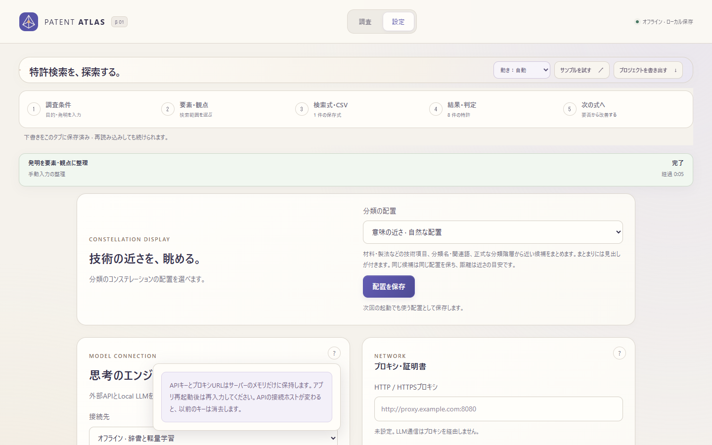

## 未実施・後続

- 探索ラボの特許集合の統合、統括の自動実行モデルへの再設計、判断エージェント処理の統合は設計目標として維持し、今回のUI変更では処理・データを統廃合していない。
- ダークテーマ層の廃止はPhase 5。日次自動改善は停止継続。
- siblingの `claudecode` が無いため、利用者指定どおりダッシュボードは `--check` のみ実行。欠落のエラーを確認し、dashboard.htmlの生成・再公開は行っていない。
- 先行Phase 0〜3cはローカル未公開コミットだったため、Phase 4のPRはPhase 3cの比較用ブランチに対する差分。mainへの取り込みは先行フェーズと順序を合わせて行う。

## 変更ファイル

- `static/`: `index.html`, `app.js`, `research-guidance.js`, `research-guidance.css`, `research-workbench.js`, `invention-workbench.js`, `discovery-ui.js`, `orchestration-ui.js`, `convergence-ui.js`, `projection-ui.js`
- `tests/`: `navigation.test.cjs`, `phase4-browser.cjs`, `research-guidance.test.cjs`, `research-workbench.test.cjs`, `orchestration-ui.test.cjs`
- `ARCHITECTURE.md`, 本書、`docs/screenshots/phase4/` の11画像
- リポジトリ規約の必須更新: `progress/projects/patent-atlas.json`
