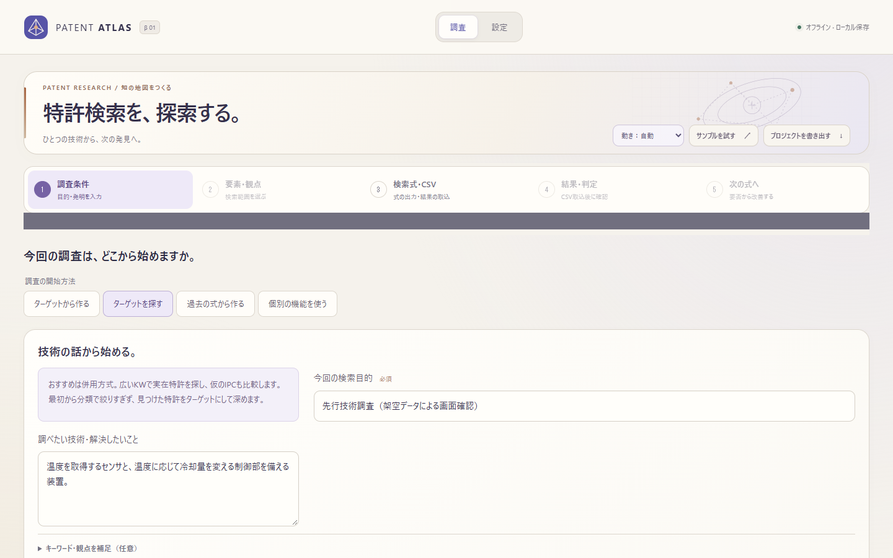
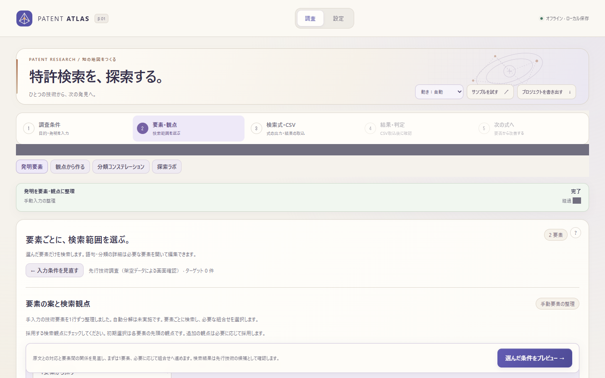
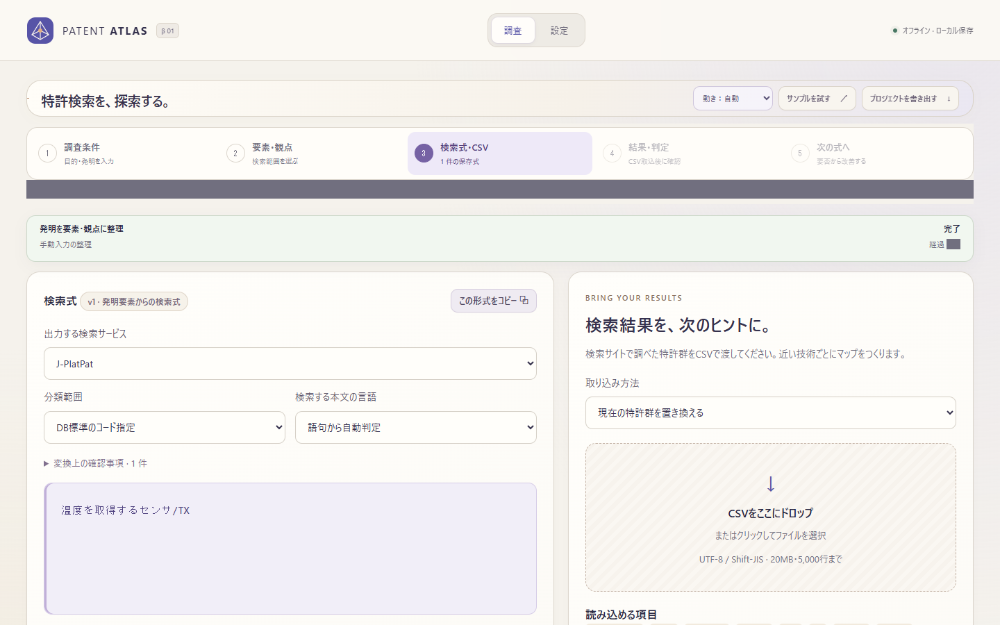
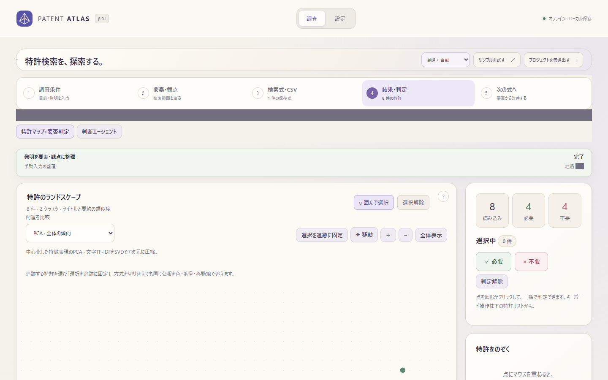
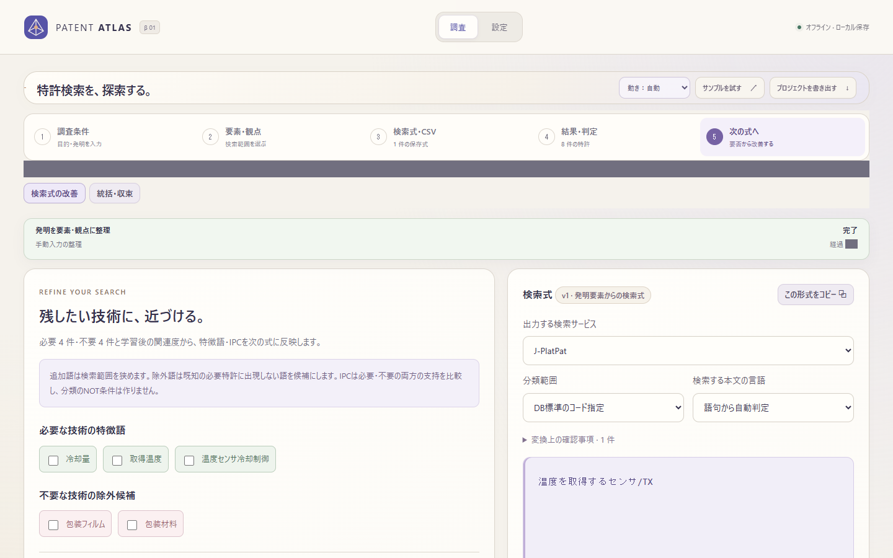
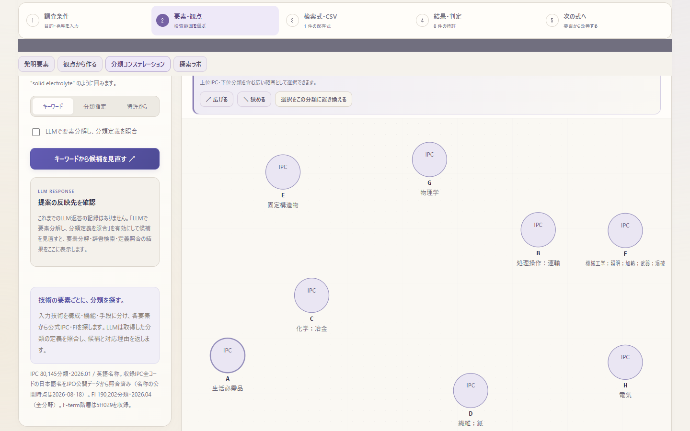
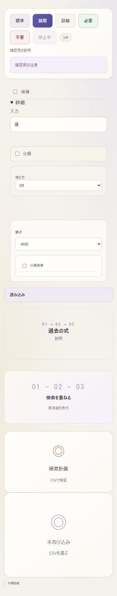

# Phase 5：CSS統合

2026-11-06。比較元はPhase 4の `d26474cbd822a7c26d00e41dee8fc5527347ab62`。機能、API、設定、保存データ、日本語の画面文言は変更していない。

## 変更

- `style.css` のダークテーマと二重のトークン定義を廃止。リセット、配置、共通部品を残し、テーマの正本は `atlas-theme.css` の明色に統一した。色はこのファイルの `:root` で宣言し、各ルールから `var(--…)` で参照する。CSSの継承色 `currentColor` はそのまま使用する。
- 色調の丸めは行わない。既存の微妙に異なる色・半透明色を `--palette-*` として保持し、主要な背景・文字・線・アクセントは既存の意味付きトークンを使う。`--panel` / `--text` は既存名の互換エイリアス。
- `--space-1`〜`--space-6` は4/8/12/16/20/24px、`--radius-s/m/l` は8/12/20px。反復する余白・角丸に使用し、異なる既存寸法は丸めず保持する。
- 共通button/pill/caption/noticeを `style.css` に集約。empty-stateは共通クラスとアイコンに統一し、`data-empty` の変数でホストごとの表示を維持する。旧invention-emptyは描画元がないため独立定義を撤去。
- `[hidden]` を1箇所に集約。ラベルや操作部品の `!important` はホストを含むセレクタへ置換した。`index.html` のCSS/JSの `?v=` は全て外した。

意図した変更はCSSの管理方法とアセットURLだけで、操作や見た目を変える仕様変更はない。

## 残した !important の理由

| 場所 | 個数 | 理由 |
|---|---:|---|
| style.css の `[hidden]` | 1 | 機能のdisplay指定・inline displayより確実に非表示を優先する。ユーザー指定の共通規則 |
| atlas-motion.css のstatic設定 | 3 | 利用者が明示した静止表示を、要素・疑似要素のanimation/transition/scroll-behaviorに優先する。将来の機能固有ルールにも停止を保証する |
| atlas-motion.css のreduced-motion | 3 | OS設定を明示dynamic設定よりも優先するアクセシビリティ規則 |

## 検証と規模

| 項目 | Phase 4 | Phase 5 |
|---|---:|---:|
| CSSファイル | 15 | 15 |
| CSS行数 | 8,921 | 9,949 |
| CSSサイズ（UTF-8・LF、未圧縮） | 171,809 bytes | 215,954 bytes |
| :root | 2 | 1 |
| [hidden] セレクタ | 13 | 1 |
| !important | 40 | 7 |

計測対象はこのブランチの `static/*.css`。依頼文の概数と異なるのはPhase 4完了時点を比較元にしたため。既存色を個別トークンとして明示し、共通部品の変数を宣言したため総行数・未圧縮サイズは増加している。ファイルの無関係な結合・圧縮は行っていない。

- Python: 542件実行、541件成功、既存の任意Transformerテスト1件スキップ。
- JavaScript: 314件成功。既存309件を維持し、トークン・非表示・共通部品・アセット読み込みの回帰5件を追加。
- 既存テスト3件は、機能CSS内の重複したhidden規則を探す期待値から、共通 `style.css` / `atlas-motion.css` を確認する期待値へ変更した。テスト削除・新規スキップはない。
- Playwright / Edge: Phase 4と同じ主要11画面、分類画面2、入口モード2、共通部品5の計20ケースで、計算済みスタイル差分0、画像差分0（pixelmatch、閾値0.1）。[比較結果](screenshots/phase5/comparison.json)。ページ例外0。
- 主要画面は1440×900。共通部品は幅1440/900/390pxの全長画像、hover/focusを含む。画面外の表示要素も計算済みスタイルで比較した。揺れる経過時間と下書き保存状態の行だけをマスクし、保存待ち完了後に計測する。
- 一時Workspace、架空CSV8件で実行。ブラウザーの外部通信を遮断。LLM・OPSを使わず、既存サーバー・実データに接続していない。

## 変更ファイル

- CSS: `static/style.css`, `atlas-theme.css`, `atlas-maps.css`, `atlas-motion.css`, `classification.css`, `discovery.css`, `convergence-ui.css`, `invention-workbench.css`, `learning-ui.css`, `orchestration-ui.css`, `patent-inspector.css`, `projection-ui.css`, `query-library-ui.css`, `research-guidance.css`, `research-workbench.css`。
- 空状態クラス: `static/app.js`, `classification-ui.js`, `convergence-ui.js`, `discovery-ui.js`, `query-library-ui.js`, `query-output.js`。ほかに `static/index.html` のアイコンとキャッシュバスター。
- テスト: `tests/convergence-ui.test.cjs`, `orchestration-ui.test.cjs`, `query-library-ui.test.cjs`, `phase4-browser.cjs`。追加は `css-system.test.cjs`, `css-visual-audit.cjs`, `compare-css.cjs`。
- 文書・記録: `ARCHITECTURE.md`, 本書、`docs/screenshots/phase5/` の比較前後画像・JSON、リポジトリ共通の `progress/projects/patent-atlas.json`。

## 再現手順

アプリ依存の追加はない。開発用Playwright、pngjs、pixelmatchとブラウザーが必要。baselineディレクトリは比較元コミットの `static/` を別の一時ディレクトリへ展開したものを指定する。

```sh
.venv/bin/python -m unittest discover -s tests -v
node --test tests/*.test.cjs
CSS_AUDIT=1 CSS_BASELINE_STATIC=/tmp/phase4-static PHASE4_SCREENSHOTS=/tmp/before node tests/phase4-browser.cjs
CSS_AUDIT=1 PHASE4_SCREENSHOTS=/tmp/after node tests/phase4-browser.cjs
node tests/compare-css.cjs /tmp/before /tmp/after /tmp/comparison
```

Windowsは `.venv\Scripts\python.exe` とPowerShellの環境変数指定を使う。必要に応じて `NODE_PATH` と `PLAYWRIGHT_EXECUTABLE_PATH` を指定する。比較ツールはスタイル差分または画像差分があれば失敗終了する。画像は合成データのみをコミットし、実行ログ・生の計算済みスタイルは一時ディレクトリに置く。

## 比較画像

各行は同じ条件で撮影したPhase 4／Phase 5。すべての比較画像は [before](screenshots/phase5/before/) / [after](screenshots/phase5/after/) にある。

| 画面 | Phase 4 | Phase 5 |
|---|---|---|
| 調査条件 |  |  |
| 要素・観点 |  |  |
| 検索式・CSV |  |  |
| 結果・判定 |  |  |
| 次の式へ |  |  |
| 分類マップ |  |  |
| 共通部品・幅390px |  |  |

## 未実施・制約

- 目視・画像比較は記載のEdgeと状態を対象とし、すべてのブラウザー／ユーザーデータの組合せを網羅してはいない。
- `claudecode` リポジトリがないため、利用者の指定どおりdashboardは `--check` のみ実行。欠落で終了するため `progress/dashboard.html` は再生成・コミット・再公開していない。
- 日次自動改善の停止は継続。Phase 6以降の機能・バックエンドの変更は行っていない。
