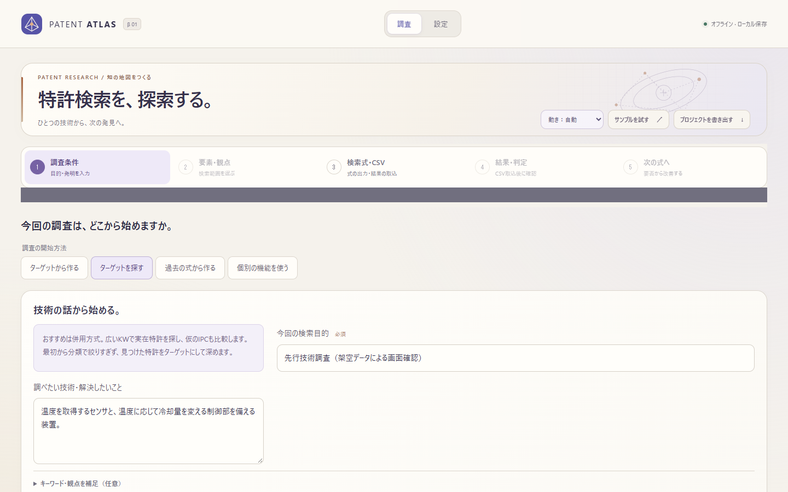
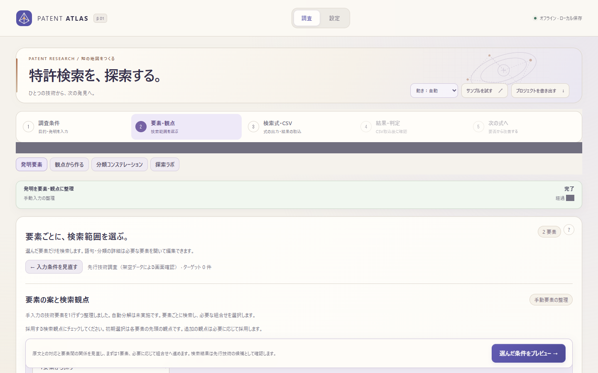
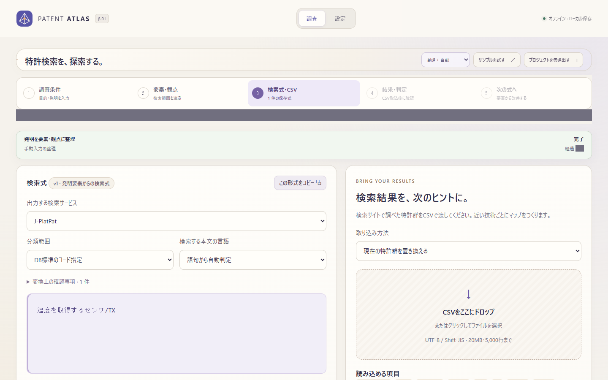
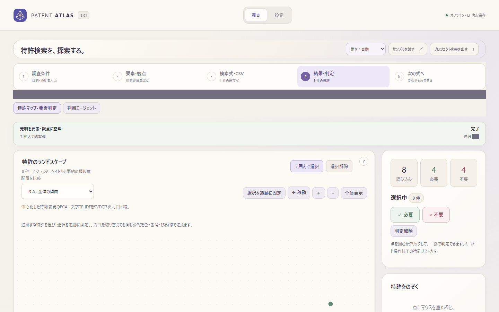
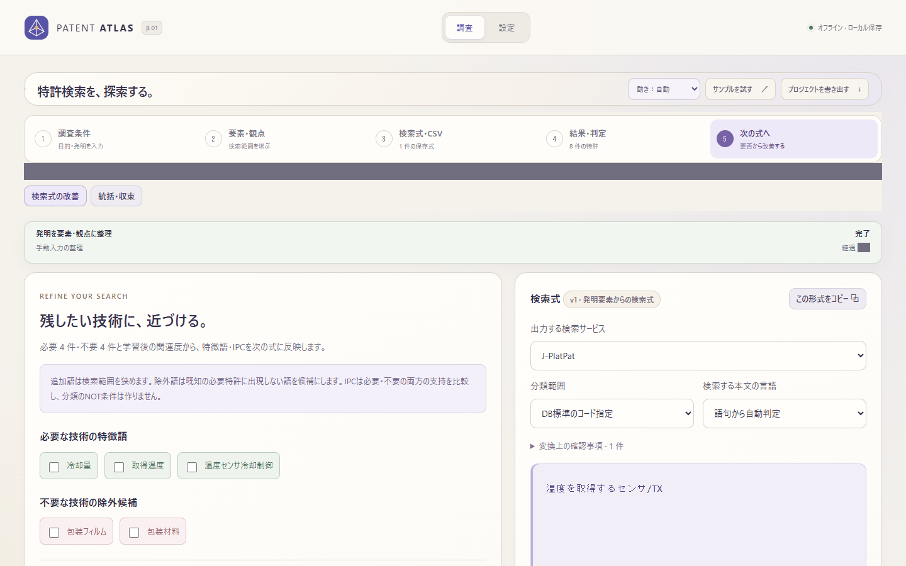

# Phase 6：フロントのモジュール化とテスト基盤

2026-11-06。実装の基点はPhase 5 `74f03d61b363fc398a54d1b4d5e380ef2a3b1f51`。画面比較はPhase 4 `d26474cbd822a7c26d00e41dee8fc5527347ab62`。

## 変更内容

1. `core.js` にDOM/APIの共通関数と状態コンテナを集約。`setState`以外で公開状態を再代入しない。ジョブの行更新は`patchRows`で既存の行オブジェクトを保つ。
2. 19本のclassic scriptを、単一の`main.js`から読み込む29本のネイティブESモジュールに変更。各依存はimportで明示し、公開する関数は他モジュール・テストで使うものに限定した。`app.js`は初期化・タブ・段階切替、描画はパネルの`render(host, snapshot)`へ分離した。CSP・API・CSS・サーバーの保存形式は変更していない。
3. `replaceHtml`で署名比較と状態の退避/復元を共通化。後から取り付ける子パネルにも未保存入力を戻す。モデル側で更新した値は優先し、式例/計画の識別子をまたいで入力を引き継がない。登録箇所をキーにイベントを更新し、同じDOMを保持しても二重実行しない。
4. エスケープ、分類キー・分類名、判定ラベル、ツールチップ座標、debounceを共通化。lassoは同じポインター処理に候補・座標・選択処理を渡す。
5. jsdomを開発用依存として追加し、VMのソース切り出しを実モジュールのimportへ置換。分類・lasso・学習・投影・設定・特許プレビューは実DOMの入力/イベント/属性を確認する。文言・未信頼文字列のエスケープを検証するケースの文字列比較は保持した。テストは削除・スキップしていない。

## 意図的に変えた挙動

- 判定による地図再描画後も`#projection-adopt-note`の入力を保持する。
- 分類コンステレーションの`.list-toggle`など、利用者が開閉した詳細欄を保持する。モードの既定値だけで開いた欄は、新しいモードの既定値に従う。
- 過去式ライブラリを`outerHTML`で交換せず、同じホスト内で更新する。入力・フォーカス・開閉状態を保持し、イベントを更新する。異なる式例の同名入力へ古い編集を混ぜない。
- lassoの再描画後も最新の候補・位置・パスを参照し、キャンセル時はポインターキャプチャを解除する。
- 分類名は`title_short_ja → title_ja → title → title_en → code`に統一。従来の統括は短い日本語名を見ず、改善パネルは英語名を原文より優先していた。調査/発明パネルの不足していた英語・コードへのフォールバックも揃えた。コンステレーションの英語切替では英語名を優先する。公式名称・参考訳の出典情報や分類コードは変更していない。

## 検証

- Python: **542件、541成功・既存の任意Transformerテスト1件スキップ**。Pythonコードと既存Pythonテストは無変更。
- JavaScript: **327件成功、スキップ0**（既存314件を保持、13件追加）。`npm ci`から再現確認。
- 作業途中のJS区切り: core抽出317件、ESモジュール317件、共通描画321件、ヘルパー統合321件、最終327件。バックエンドは初回・最終とも同じ542件で緑。
- モジュール存在確認用のtypeofガード0、core外の公開state再代入0、VM実行・関数位置による切り出し0。データ型を検証するtypeofは保持。
- Playwright / Edge: 隔離CSV8件、外部ネットワーク遮断、実LLMは未実行。主要画面1440×900、補助画面と幅390/900px・hover/focusを含む20ケース。入力保持3件も追加の操作列でブラウザー確認（画像比較とは別実行）。
- 画面比較: 20ケースすべてで計算済みスタイル差分0・画像差分0（pixelmatch閾値0.1）。[比較結果](screenshots/phase6/comparison.json)。Phase 4と同じ操作列でポインターの一時フォーカスとhoverを同条件に揃えて計算済みスタイルと画像を比較。フォーカス保持自体は別の回帰テストで確認する。

## 変更ファイル一覧

- 実行入口: `static/index.html`, `static/main.js`, `static/app.js`, `static/ui-session.js`。
- 共通処理: `static/core.js`, `static/lasso.js`, `static/atlas-motion.js`, `static/classification-labels.js`, `static/classification-layout.js`, `static/patent-inspector.js`。
- パネル: `static/agent-ui.js`, `static/map-ui.js`, `static/settings-panel.js`, `static/workflow-ui.js`, `static/workspace-chrome.js`, `static/job-ui.js`。
- 既存パネル: `static/classification-ui.js`, `convergence-ui.js`, `discovery-ui.js`, `invention-workbench.js`, `learning-ui.js`, `orchestration-ui.js`, `projection-ui.js`, `query-library-ui.js`, `query-output.js`, `refinement-ui.js`, `research-draft-store.js`, `research-guidance.js`, `research-progress.js`, `research-workbench.js`。
- 開発依存: `.gitignore`, `package.json`, `package-lock.json`。対象アプリのCIでのみnpm ciを追加するため、リポジトリ共通の`.github/workflows/patent-atlas.yml`も更新。
- テスト: `tests/module-harness.cjs`, `core.test.cjs`, `modules.test.cjs`, `rendering.test.cjs`を追加。既存UIテストのimportとアサーションを移行。`phase4-browser.cjs`, `css-visual-audit.cjs`で旧版/新版の起動と回帰を確認。
- 文書・進捗: `ARCHITECTURE.md`, 本書、`tests/README.md`, `docs/screenshots/phase6/`, リポジトリ共通の`progress/projects/patent-atlas.json`。

### 移行した既存テスト

`tests/atlas-motion.test.cjs`, `tests/classification-provenance-ui.test.cjs`, `tests/classification-ui.test.cjs`, `tests/convergence-ui.test.cjs`, `tests/discovery-ui.test.cjs`, `tests/invention-workbench.test.cjs`, `tests/lasso.test.cjs`, `tests/learning-ui.test.cjs`, `tests/navigation.test.cjs`, `tests/orchestration-ui.test.cjs`, `tests/patent-inspector.test.cjs`, `tests/projection-ui.test.cjs`, `tests/query-library-ui.test.cjs`, `tests/query-output.test.cjs`, `tests/refinement-ui.test.cjs`, `tests/research-draft-store.test.cjs`, `tests/research-guidance.test.cjs`, `tests/research-progress.test.cjs`, `tests/research-workbench.test.cjs`, `tests/settings-ui.test.cjs`。

## 実行方法・未解決事項

`tests/README.md`にテスト環境とモックの境界を記載した。通常利用はこれまでと同じPython起動で、ビルド操作は不要。

機能上の未解決事項は今回の検証では検出していない。隣接するclaudecodeリポジトリがないため、指定に従いダッシュボードは`--check`のみ実行し、生成・公開は行わない。Phase 2の将来設計（ラボ/判断エージェントの統合など）には着手していない。

## 画面

灰色の帯・小枠は時刻と非同期の下書き保存状態を除外する比較用マスクで、通常のUIには表示されない。

Phase 4の比較前画像は[既存の比較記録](PHASE5_REVIEW.md#画面比較)にも保存されている。

| 段階 | Phase 6 |
|---|---|
| 調査条件 |  |
| 要素・観点 |  |
| 検索式・CSV |  |
| 結果・判定 |  |
| 次の式へ |  |
